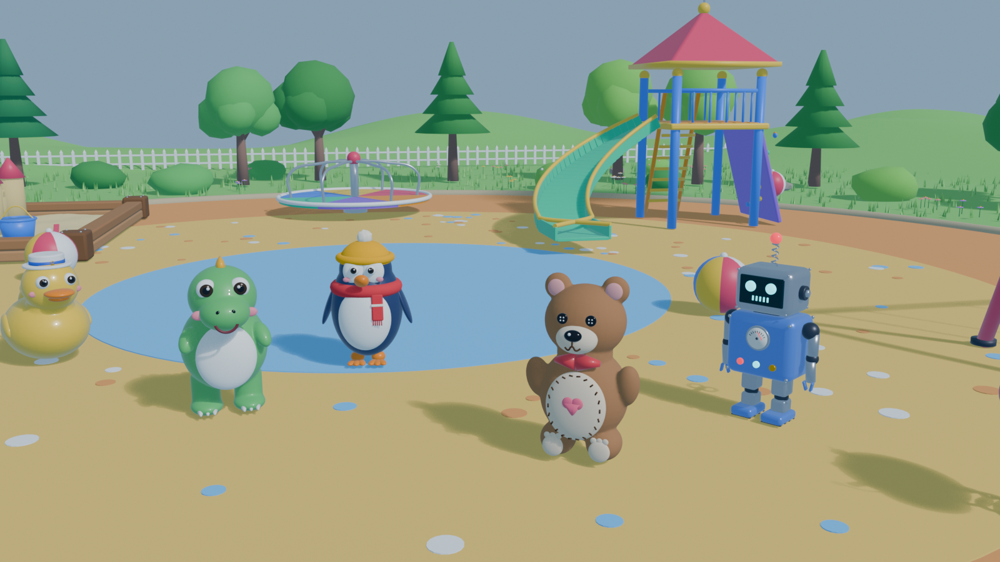
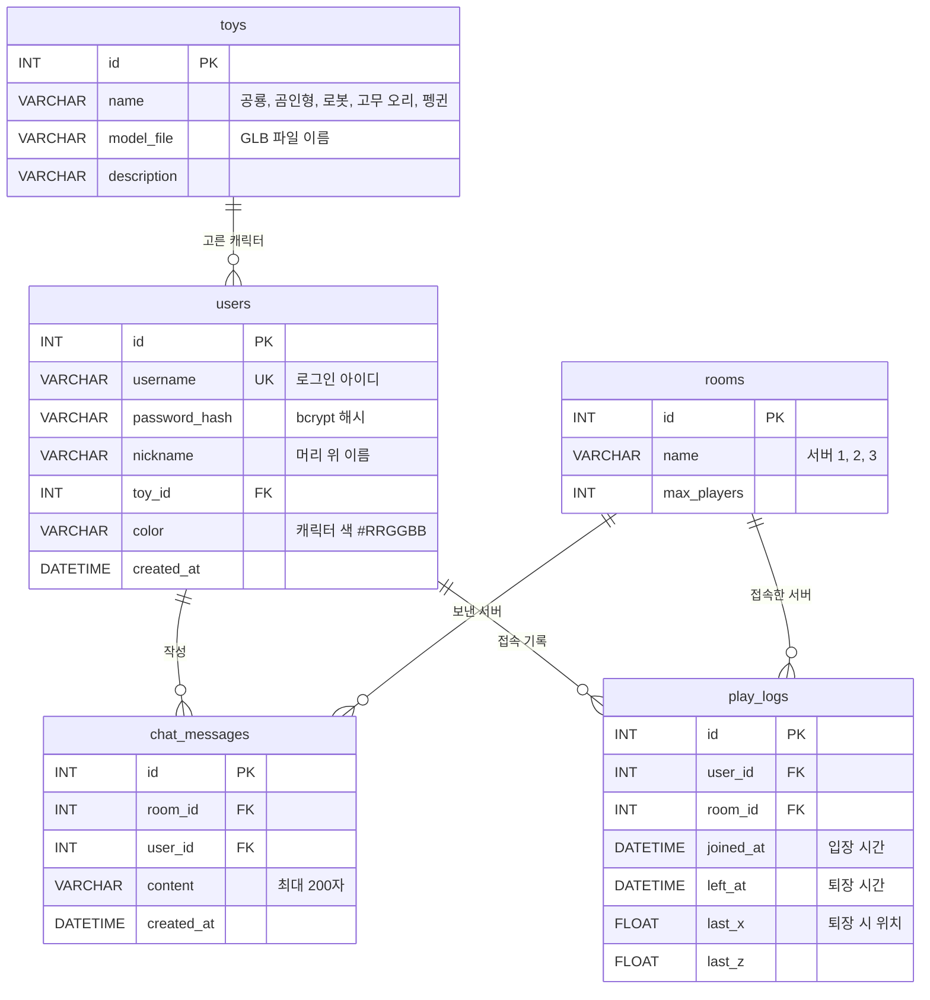

# 🧸 Toy Playground (장난감 놀이터)

장난감 캐릭터(공룡, 곰인형, 로봇, 고무 오리, 펭귄)가 되어 3D 놀이터를 돌아다니며 같은 서버의 친구들과 실시간으로 채팅하는 웹 게임입니다.

- 서버: Node.js + Express + EJS + mysql2 + socket.io + express-session + bcrypt
- 클라이언트: Three.js (GLTFLoader, CSS2DRenderer), 순수 JavaScript
- DB: MariaDB (로컬 개발은 MySQL 8)
- 3D 모델: 캐릭터 5종과 놀이터 맵 모두 Blender에서 기본 도형을 조합해 직접 제작 → GLB로 내보냄 (`assets/blender/toys.blend`)



## 화면 흐름

1. **메인**: 로그인 / 회원가입 (비밀번호는 bcrypt 해시로 저장)
2. **서버 선택**: 장난감과 색깔을 고르고 서버 1~3 중 하나에 입장 (서버별 현재 인원이 3초마다 갱신됨)
3. **놀이터**: WASD 이동, Space 점프, 우클릭 드래그로 시점 회전, 휠로 확대/축소, Enter로 채팅, 1~6 이모티콘
   - 왼쪽 위 채팅 로그 패널, 캐릭터 머리 위 닉네임과 말풍선, 이모티콘(👋😂❤️😮👍🎉)
   - 같은 서버에 있는 사람끼리만 위치와 채팅이 실시간으로 공유됨

## 폴더 구조

```
app.js              서버 시작점 (Express, 세션, 라우트, socket.io 연결)
db.js               MariaDB 연결 풀
schema.sql          테이블 생성 + 기본 데이터
routes/auth.js      메인, 회원가입, 로그인, 로그아웃
routes/lobby.js     서버 선택, 입장, 놀이터 화면, 인원 API
sockets/index.js    실시간 기능 (입장/퇴장, 채팅 저장, 위치 동기화)
game/rooms.js       서버 1~3의 접속자와 위치 (메모리)
views/              EJS 화면 (index, servers, play)
public/js/play.js   놀이터 화면: 서버 연결 + 채팅 (3D가 실패해도 채팅은 동작)
public/js/game3d.js 3D 장면, 이동, 카메라, 닉네임/말풍선
public/js/map.js    예비 놀이터 맵 (playground.glb를 못 불러올 때 코드로 만드는 맵)
public/js/characters.js  캐릭터 모델 불러오기 + 색 바꾸기
public/models/      캐릭터 GLB 5종 + 놀이터 맵 playground.glb
assets/blender/     Blender 원본 (캐릭터 5종 + 놀이터 씬)
assets/renders/     Blender 렌더 이미지
tools/test-bot.js   혼자서 멀티플레이를 테스트하는 봇
```

## DB 설계 (ERD)



| 테이블 | 언제 쓰이나 |
| --- | --- |
| `toys` | 서버 선택 화면의 캐릭터 목록, 놀이터에서 불러올 GLB 파일 이름 |
| `users` | 회원가입/로그인, 고른 캐릭터와 색 저장 |
| `rooms` | 서버 1~3 목록과 최대 인원 |
| `chat_messages` | 채팅을 보낼 때 저장, 입장할 때 최근 30개 불러오기 |
| `play_logs` | 입장할 때 기록 추가, 퇴장할 때 퇴장 시간과 마지막 위치 저장 → 다음 입장 때 그 자리에서 시작 |

캐릭터 위치(점프 높이 포함)는 1초에 여러 번 바뀌므로 DB가 아니라 서버 메모리(`game/rooms.js`)에서 관리하고, 1초에 약 15번 같은 서버 사람들에게 보냅니다. DB에는 퇴장할 때 마지막 위치만 저장합니다. 이모티콘도 순간적인 표현이라 DB에 저장하지 않고 같은 서버 사람들에게 바로 전달만 합니다.

## 로컬에서 실행하기

```bash
npm install
cp .env.example .env          # DB 계정, 세션 비밀키 입력
mysql -u root -p < schema.sql # DB와 테이블 생성 (DB 계정은 따로 만들고 권한 부여)
npm run dev                   # 파일을 고치면 자동 재시작
```

브라우저에서 http://localhost:3000 접속. 혼자 테스트할 때는 봇을 띄우면 됩니다.

```bash
node tools/test-bot.js 1 3    # 서버 1에 봇 3명 (봇 계정 bot_1, bot_2 ... 이 DB에 만들어짐)
```

## EC2에 배포하기

처음 한 번:

```bash
git clone https://github.com/dongpal0825/toy-Playground.git toy-playground
cd toy-playground
npm ci --omit=dev
sudo mysql < schema.sql      # DB, 테이블, 기본 데이터 (다시 실행해도 기존 데이터 유지)
# MariaDB에 앱 전용 계정(toy_user)을 만들고 .env.example을 복사해 .env 작성
npm i -g pm2
NODE_ENV=production pm2 start app.js --name toy-playground --max-memory-restart 300M
pm2 startup                  # 출력된 sudo 명령을 실행하면 재부팅 때 자동 시작
pm2 save
```

코드를 고친 뒤 업데이트:

```bash
git pull
npm ci --omit=dev
pm2 restart toy-playground
```

보안 그룹에서 3000번 포트가 열려 있어야 합니다. 웹 페이지와 실시간 통신(WebSocket)이 같은 3000번 포트를 사용합니다.
